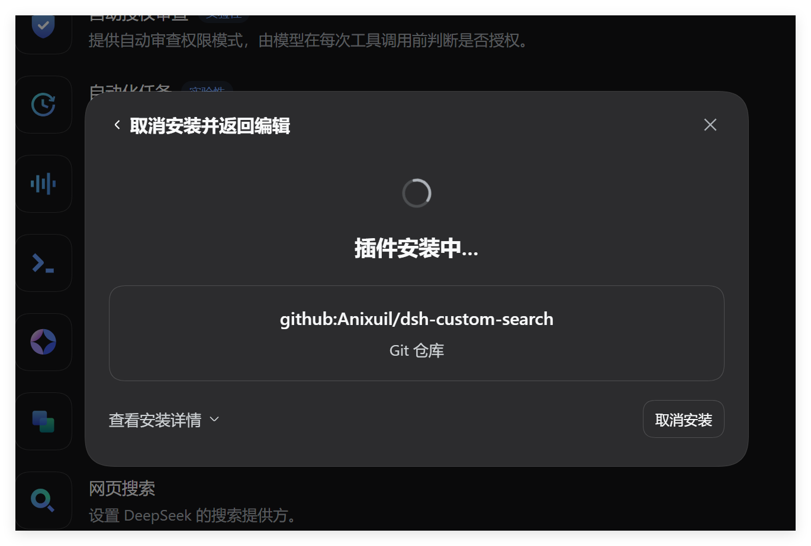
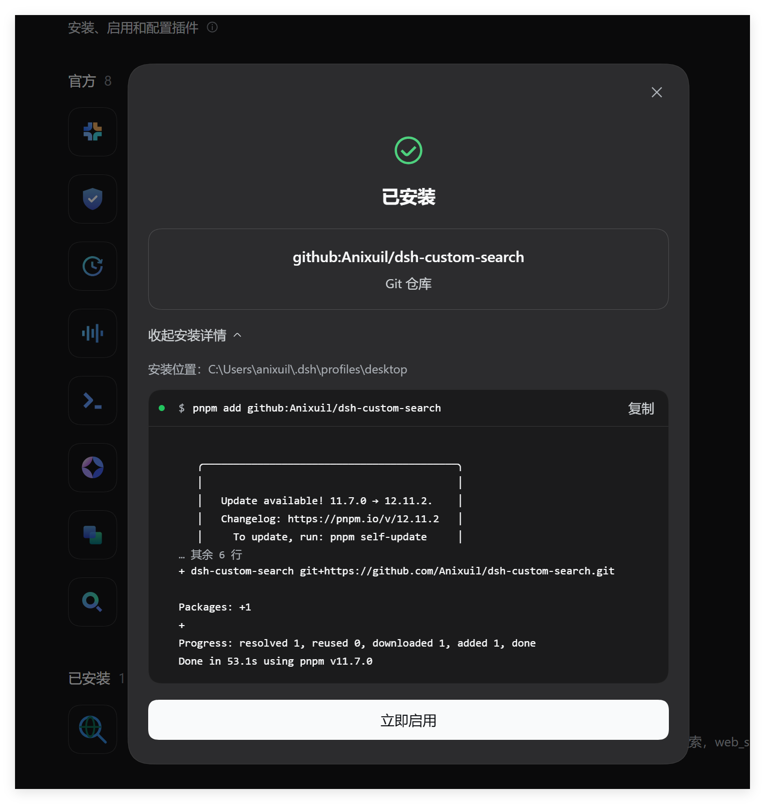

# dsh-custom-search

> A DeepSeek Harness plugin that replaces the built-in DeepSeek web search with a
> search engine you choose — SearXNG, Tavily, Exa, Brave, Serper, Bing, or Google
> CSE. The model-facing `web_search` tool keeps its name and schema, so prompts,
> agent presets, and tool lists are unchanged.

用你自己的搜索源替换 DSH 内置的「仅官方 DeepSeek」搜索。`web_search` 工具名与参数保持不变，
换的只是背后的检索通道——所以模型的提示词、工具表、Agent 预设都不用动。

> **第三方社区插件。** 本项目与 DeepSeek 官方无隶属关系，也不属于官方插件市场。
> 下文「官方搜索」「官方提供方」一律指 DSH 自带的 `@deepseek-ai/dsh-web-search-deepseek`。

---

## 它替换的到底是什么

DSH 把「联网搜索」拆成了三层，本插件只接管最底下那层：

| 层 | 包 | 职责 | 本插件是否改动 |
|---|---|---|---|
| 工具层 | `@deepseek-ai/dsh-tool-web` | 向模型暴露 `web_search` / `web_fetch` | 不改 |
| 服务层 | `@deepseek-ai/dsh-web`（`ctx.web`） | 选后端、取消、错误码、`maxResults` 截断 | 只改一个配置值 |
| 提供方层 | `@deepseek-ai/dsh-web-search-deepseek` | 真正发请求、返回结果 | **替换掉** |

服务层通过 `registerSearchProvider()` 收集提供方，并按**配置里 pin 的 id** 选一个执行。
官方提供方注册的 id 是 `deepseek-official`，本插件注册 `custom-search`——
所以「换搜索引擎」在 DSH 里就是改一个字符串，不需要替换任何官方文件。

这也意味着：官方搜索的**一个查询要花一整轮模型调用**（DeepSeek 没有独立的检索接口），
而接上 SearXNG / Tavily 这类真正的检索 API 后，搜索不再消耗会话模型的 token。

## 安装

**从 GitHub 安装**（推荐）

```bash
dsh plugin --profile desktop add github:Anixuil/dsh-custom-search#main
```

**从本地目录安装**（开发调试，改完重启即生效）

```bash
dsh plugin --profile desktop add <本仓库的绝对路径>
```

也可以走桌面端面板：在「+ 添加插件」里填本仓库的绝对路径或上面的 GitHub 地址。

<p align="center">
  
  
</p>

左：面板把 `github:Anixuil/dsh-custom-search` 识别为「Git 仓库」来源，底层走 `pnpm add` 拉取。
右：安装完成，落点是 profile 目录 `~/.dsh/profiles/desktop`，点「立即启用」。

> 面板那一栏填的是**安装源**（npm 包名 / GitHub 源 / 本地路径），不是插件名。
> 直接填 `dsh-custom-search` 会提示「未找到相关插件」——这个名字在 npm 上还没发布。

装完**重启 Harness** 才生效（bundle 类插件不会热加载）。桌面端用「重启 Harness」或退出重开。

> `desktop` 是 DeepSeek Harness 桌面端的 profile 名（数据目录 `~/.dsh/profiles/desktop`）。
> 如果你用的是 CLI 或其他 profile，换成实际名称，例如
> `dsh plugin --profile web add github:Anixuil/dsh-custom-search#main`。

> 本插件没有构建步骤，`github:` 源可以直装。若 pnpm 仍拦下构建脚本，
> 在 `$DSH_HOME/profiles/desktop/pnpm-workspace.yaml` 的 `allowBuilds` 里放行 `dsh-custom-search`。

### 兼容性

provider 契约（`ctx.web.registerSearchProvider` 与返回结构）是照着
**`@deepseek-ai/dsh-*` 0.2.0-rc.2**（DeepSeek Harness Desktop 0.2.0-rc.2）的源码实现的，
并对该版本做过离线契约验证。

> DSH 仍在 developer preview：`apply(ctx)` 规范稳定，但 `ctx.web` 这类服务在预览版之间
> 仍可能调整。升级 Harness 后若搜索报 `WEB_PROVIDER_*` 错误，先对照
> `@deepseek-ai/dsh-web` 的 `registerSearchProvider` 签名和 `WebRuntime.Config` 字段。

## 配置

设置 → 插件 → 插件配置 → **自定义搜索引擎**。
表单由插件 `Config` schema 里标记为 `volatile()` 的字段自动生成，改动**立即生效，不用重启**。

| 字段 | 默认 | 说明 |
|---|---|---|
| `engine` | `searxng` | 主搜索引擎，可选 `searxng` / `tavily` / `exa` / `brave` / `serper` / `bing` / `google` |
| `fallback` | 空 | 逗号分隔的备用引擎，按顺序兜底（主引擎报错或返回空结果时启用） |
| `endpoint` | 空 | 主引擎的接口基址。留空则用该引擎的官方地址；自建 SearXNG 填 `http://127.0.0.1:8080` |
| `endpoints` | 空 | 按引擎分别指定基址的 JSON，例如 `{"tavily":"https://gw.internal/tavily"}`，优先级高于 `endpoint` |
| `apiKey` | 空 | API key 字面量。标记为 secret，不会回显、不进模型上下文 |
| `apiKeyEnv` | 空 | 凭证引用名。留空则用该引擎约定的环境变量（见下表） |
| `googleCx` | 空 | 仅 Google CSE 需要：Programmable Search 的搜索引擎 ID |
| `searchDepth` | `basic` | 仅 Tavily：`basic` / `advanced`（advanced 消耗更多额度） |
| `maxResults` | `8` | 单次搜索最多返回多少条来源，上限 20 |
| `timeoutMs` | `20000` | 单次搜索超时（毫秒） |
| `language` | `zh-CN` | 语言/地区提示，各引擎会映射成自己的参数 |
| `safeSearch` | `moderate` | `off` / `moderate` / `strict`，引擎不支持时忽略 |

### 各引擎怎么准备

| 引擎 | 是否要 key | 约定的环境变量 | 备注 |
|---|---|---|---|
| `searxng` | 否 | — | 自建或公共实例，**必须在实例的 `settings.yml` 里开启 `json` 输出格式**，否则接口返回 403 |
| `tavily` | 是 | `TAVILY_API_KEY` | 为 AI 检索设计，按次计费 |
| `exa` | 是 | `EXA_API_KEY` | 语义检索，可直接拿到正文片段 |
| `brave` | 是 | `BRAVE_API_KEY` | 独立索引，免费额度较宽裕 |
| `serper` | 是 | `SERPER_API_KEY` | Google 结果的低延迟代理 |
| `bing` | 是 | `BING_API_KEY` | Azure 认知服务 Web Search |
| `google` | 是 | `GOOGLE_API_KEY` | 还需填 `googleCx` |

**key 的解析顺序**：`apiKey` 字面量 → 凭证服务（设置页写入的） → 启动环境 → 进程环境变量。

> `apiKey` / `apiKeyEnv` 只作用于**当前选中的主引擎**。`fallback` 里的引擎是别的厂商，
> 各自从自己的环境变量或凭证服务取 key——例如 `engine: searxng` + `fallback: tavily`
> 只需要额外准备 `TAVILY_API_KEY`。

### 常见组合

**全本地、不花一分钱**（推荐先跑通这个）

```yaml
engine: searxng
endpoint: http://127.0.0.1:8080
```

**要更稳，主引擎挂了自动兜底**

```yaml
engine: searxng
endpoint: http://127.0.0.1:8080
fallback: tavily
```

## 安装后的实际改动

`cordis.patch.yml` 往 profile 组合里写了三行：

```yaml
- insert:
    - id: custom-search            # 本插件的行
      name: dsh-custom-search
      config: { ... }

    - id: web                      # 把服务层指向本提供方
      name: '@deepseek-ai/dsh-web'
      config:
        searchProvider: custom-search
        fetchProvider: http        # 必须保留：patch 是整行替换，不是深合并

    - id: web-search-deepseek      # 关掉官方提供方
      name: '@deepseek-ai/dsh-web-search-deepseek'
      disabled: true
```

两个容易踩的点：

1. **patch 是整行替换**。`web` 那一行必须把 `fetchProvider` 一起写回去，
   否则 `web_fetch` 会失去后端。
2. **关掉官方提供方是为了避免歧义**。服务层在没 pin id 时会要求「恰好一个可用提供方」；
   两个都在就会报 `WEB_PROVIDER_AMBIGUOUS`。想让官方搜索和本插件并存，
   把 `disabled: true` 改成 `false`，并确保 `searchProvider` 始终有值。

## 回到官方搜索

任选一种：

- 设置 → 插件 里停用 `dsh-custom-search`，再到 设置 → 插件 → 插件配置 → `web`，
  把 `searchProvider` 改回 `deepseek-official`，并把 `web-search-deepseek` 重新启用；
- 或直接从 profile 的 `cordis.patch.yml`（`$DSH_HOME/profiles/desktop/cordis.patch.yml`）
  删掉上面三行覆盖——profile patch 优先级比 bundle 高，能压过本插件。

卸载：

```bash
dsh plugin --profile desktop remove dsh-custom-search
```

`remove` 只删依赖、**不会回写 patch 层**，所以还要手工删掉上面那三行。

## 安全说明

- 插件以 Harness 进程的权限运行，安装前请自行审阅源码——这是所有 DSH 插件的通用前提。
- 携带 API key 的请求使用 `redirect: 'error'`，重定向会在发出前被拒绝，
  避免凭证被转发到未核实的主机。免 key 的 SearXNG 允许跟随重定向（常见的 http→https）。
- 返回的 URL 只接受绝对 `http(s)` 地址，其他一律丢弃，不会出现在给模型的结果里。
- `apiKey` 标记为 secret：设置页不回显，也不会进入模型上下文。
- 搜索结果是外部不可信内容，工具层会照常标注为 untrusted。

## 已知限制

- `ctx.web` 的搜索请求只有 `query` 和 `maxResults` 两个参数，所以**没有**时间范围、域名过滤、
  站点限定这类 provider 级控制（这是服务层的既定边界，不是本插件的取舍）。
- `search()` 是每次查询一次请求。`fallback` 里多个引擎串行尝试，最坏情况耗时是各超时之和。
- `available()` 必须是同步、离线的，所以只检查「key 是否配好」，不会去探测引擎是否可达；
  SearXNG 实例挂了会体现为搜索报错，而不是提供方不可用。

## 目录结构

```
dsh-custom-search/
├── index.js          插件入口：Config schema、provider 注册、凭证解析、兜底链
├── engines.js        引擎适配表：每个引擎的 build（怎么发请求）+ parse（怎么读响应）
├── cordis.patch.yml  安装时写入 profile 组合的三行覆盖
├── package.json      dsh.bundle.patch 声明、icon、locale、files 白名单
├── locale/           面板显示用的中英文标题与描述
├── icon.svg
├── docs/             README 用的安装截图
└── dev/              离线验证套件（不随插件分发，files 白名单已排除）
    ├── smoke.mjs     13 项：provider 契约、归一化、去重、兜底、取消、错误码
    ├── validate.mjs  15 项：清单、patch 方言、patch 与 Config schema 对齐
    └── asar.py       从 DSH 安装包里抽源码/依赖的解析脚本
```

## 开发

```bash
# 本地目录直装，改完重启 Harness 生效
dsh plugin --profile desktop add D:\code\self\all\dsh-custom-search
```

新增一个搜索引擎 = 在 `engines.js` 的 `ENGINES` 里加一个条目，声明 `build` 和 `parse`，
再到 `index.js` 的 `Config.engine` union 里加上这个 id。

### 验证

`dev/` 下的套件**直接 import 上级目录的真实代码**，没有副本需要同步：

```bash
cd dev
node smoke.mjs      # 起本地 mock server，用 stub ctx.web 驱动真实插件模块
node validate.mjs   # 校验清单、patch 方言以及 patch 与 Config schema 的对齐
```

两个脚本需要 `js-yaml`、`@deepseek-ai/schemastery`、`@deepseek-ai/cosmokit`
（已放在本目录的 `node_modules/`，被 `.gitignore` 忽略）。
`@deepseek-ai/*` 那几个是 DSH 自带的 vendor 包，可从本机安装里抽：

```bash
python dev/asar.py list "node_modules/@deepseek-ai/schemastery"
python dev/asar.py extract "node_modules/@deepseek-ai/schemastery" node_modules
```

> `asar.py` 默认指向 `%LOCALAPPDATA%\Programs\DeepSeek Harness\resources\app.asar`；
> 换机器时改脚本顶部的 `ASAR` 常量即可。

## 许可证

MIT
